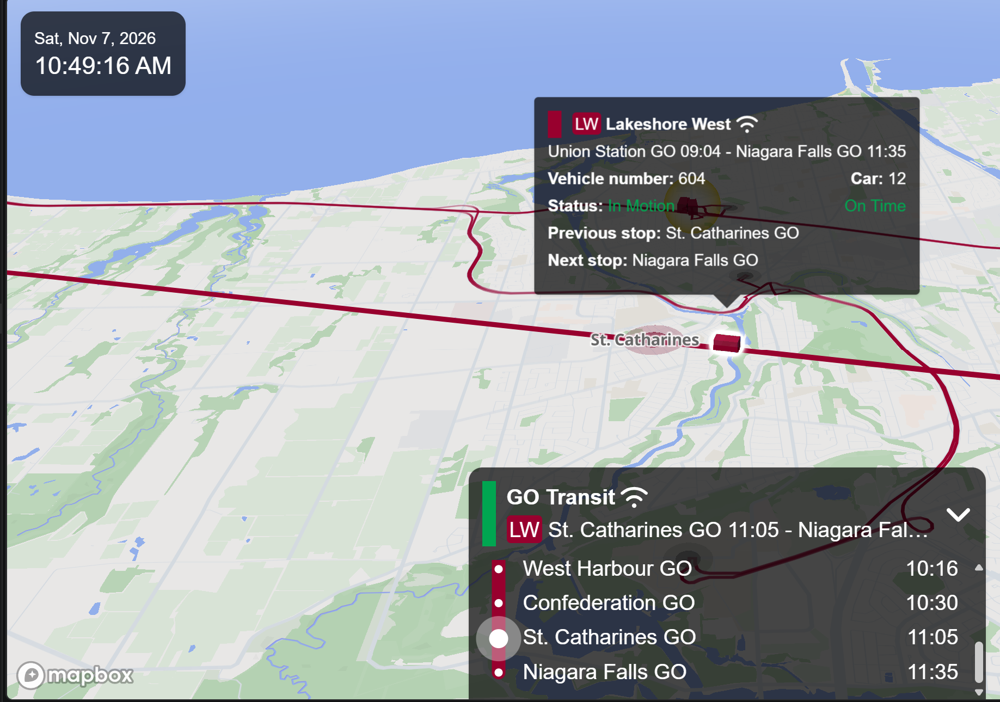

## Prompt: Fix vehicle position and motion errors in the Mini-GO Transit 3D tracker

### Task

Fix the two problems below in the Mini-GO Transit 3D tracker, in the order the user picks.
Discuss the plan before building; do not change code casually.

### Context
- Project: Mini-GO Transit 3D tracker, a fork of nagix/mini-tokyo-3d (v4.1.0).
  Live at [https://zhenhuasun.github.io/mini-gotransit-3d/](https://zhenhuasun.github.io/mini-gotransit-3d/), repo
  zhenhuasun/mini-gotransit-3d (branch master).
- Scope: GO Transit (Toronto, Canada) trains and buses only.
- Data: GTFS static feed (slimmed to a 3-day window, refreshed daily by a GitHub
  Action, served from the repo) + GTFS-RT VehiclePositions (15 s) and TripUpdates
  (30 s) via a Cloudflare Worker proxy at [https://go-3d-tracker-proxy.zhenhuasun.workers.dev](https://go-3d-tracker-proxy.zhenhuasun.workers.dev) (endpoints /api/gtfs-rt/vp, /api/gtfs-rt/tu).
- Stack: mapbox-gl + Three.js + a custom GPGPU compute renderer.
- All code, comments and UI strings in English.

### How the engine works (the parts that matter here)
- Time domain: all times are milliseconds since the last 3am (transit day).
  Clock: src/clock.js.
- Vehicles are plain JS Bus objects (src/data-classes/bus.js): trip, shape feature,
  offsets[] (each stop's distance along the shape), offset (snapped GPS distance),
  plus sectionIndex, sectionLength, stop, departureTime, instanceID, _t.
- Motion is section-based: a vehicle animates stop to stop. busRepeat (src/map.js)
  computes per-section animation parameters (start time, duration from an
  accelerate-cruise-decelerate physics profile, normalized acceleration) and writes
  them into GPU textures via traffic-layer.updateObject. Every frame, the compute
  shader (src/gpgpu/compute-fragment.glsl) interpolates the distance along the
  shape, binary-searches the route texture for the node, and outputs lon/lat,
  heading and opacity; instanced meshes sample the resulting position textures.
  JS never computes a per-frame position; it only re-programs a vehicle when its
  section changes or a realtime tick re-anchors it.
- Live mode: vehicles are created ONLY by the VehiclePositions tick
  (refreshRealtimeBusData, src/map.js ~3400), every 15 s. Playback mode: vehicles
  are created ONLY by the timetable sweep (refreshBuses, src/map.js ~1938,
  every 60 s).
- In live mode the VP tick only sets bus.stop / bus.status; the section is
  recomputed only when busRepeat fires.

### Problem 1: vehicles render ~one stop ahead of their true position (live mode)

Evidence (observed 2026-11-07, live mode):

- Train: Lakeshore West, westbound to Niagara Falls. Union Station GO 09:04 ->
  Niagara Falls GO 11:35, vehicle 604, 12 cars. Scheduled stops at the end of the
  trip: West Harbour GO 10:16, Confederation GO 10:30, St. Catharines GO 11:05,
  Niagara Falls GO 11:35.
- Screenshot at 10:49:16 (Sat, Nov 7, 2026): the 3D box is already past
  St. Catharines GO, heading toward Niagara Falls. The hover popup shows
  "Status: In Motion / On Time, Previous stop: St. Catharines GO, Next stop:
  Niagara Falls GO". The vehicle-panel header reads "St. Catharines GO 11:05 -
  Niagara Falls GO" and the panel dot sits at St. Catharines.
- Expected: about 16 min before the scheduled 11:05 arrival, and with the popup
  reporting "On Time", the train should be between Confederation GO and
  St. Catharines GO, with St. Catharines as the NEXT stop. The map shows it one
  full section ahead (St. Catharines -> Niagara Falls).
- Confederation -> St. Catharines is a long section (scheduled 35 min), so the
  one-section offset is very visible here.
- To verify: pull VP for this trip near 10:49 and confirm its GPS position lies
  between Confederation and St. Catharines (record the tripId, lat/lon and
  distance from St. Catharines in this section).

Root causes (verified in code + live data):
- GO's VehiclePositions never carries current_stop_sequence (0 of 275 entities
  on 2026-11-06; re-checked 2026-11-07). The if (stop) branch in
  refreshRealtimeBusData (src/map.js ~3420) is dead code for GO; the engine
  always takes the GPS-snap path.
- The GPS snap only determines the NEXT stop: bus.stop =
  trip.stopSequences[...] (src/map.js ~3467). The snapped GPS distance is stored
  in bus.offset but never used for rendering. traffic-layer.updateObject
  (src/layers/traffic-layer.js ~274) interpolates only between
  offsets[sectionIndex] and offsets[sectionIndex + sectionLength].
- setBusSectionData (src/map.js ~4823) maps bus.stop (the next stop) to a section
  starting AT that stop: currentSection = stopSequences.indexOf(bus.stop);
  nextSection = currentSection + 1. The vehicle is animated from the next stop
  onward, one full section ahead. In the example, the next stop is St. Catharines,
  so the train is drawn on St. Catharines -> Niagara Falls. The hover popup, the
  vehicle panel and the 3D box all derive from the same sectionIndex (popup
  nextStopIndex, src/map.js ~2379), so they are consistently wrong together.
- Animation speed is wrong for trains and not timetable-clamped for VP-tracked
  vehicles: maxBusSpeedKMPH is 30 (src/configs.js:107) and applies to all GO
  vehicles (trains are 'bus' objects in the GTFS path; real GO trains run
  ~100 km/h). departureTime / nextDepartureTime are never set in the VP branch
  of setBusSectionData, so maxDuration is undefined and section duration is
  pure physics at 30 km/h.
- Secondary amplifier: the GPS snap's starting weight is the last snapped
  bus.offset, and nearestCloserPointOnLine
  (src/turf/nearest-closer-point-on-line.js) scores candidates with
  |totalDistance - location| / 100 plus fast-path pruning, a forward bias that
  makes later snaps reluctant to correct backward (a soft ratchet, not a hard
  rule).

### Problem 2: vehicles appear "on the road" before departure (trains and buses)

Evidence (verified against live data):
- 2026-11-06 17:38: 47 of 275 VP entities were for trips not yet departed (9 at
  30+ min lead, worst 68 min).
- 2026-11-07 07:25: KI train 20261107-GT-3810 departing Kitchener 07:50 was
  already in VP 24 min early, STOPPED_AT at Kitchener GO (0.3 km away). Buses
  staged at origin terminals (0.0-0.2 km away) up to 49 min early.

Root cause: the VP handler (src/map.js ~3434-3480) creates a vehicle for ANY
tripId VP reports, with no check that now is within the trip's service window,
unlike refreshBuses (src/map.js ~1938), which checks departureTimes[0] <= now <=
last departure. GO's VP reports vehicles under upcoming trips (staged at the
origin, or finishing a previous run) and the engine draws them on that trip's
route at the next stop ahead of their GPS.

### Fix directions (each independent; pick an order)
- GPS re-anchoring (the real fix for Problem 1): render from the snapped GPS
  offset, not just the next stop. Set the section and the in-section offset from
  the GPS distance on every 15 s VP tick. Biggest change: src/map.js (VP
  handler, setBusSectionData, busRepeat; possibly busStart) + the
  section-index-to-distance seam in src/layers/traffic-layer.js updateObject.
  The compute shader probably does not need changes (it only consumes start/end
  distances, start time, duration, acceleration).
- Service-window gate (the fix for Problem 2): do not create or render a vehicle
  for a trip whose first departure is in the future; mirror the refreshBuses
  check. Smallest change: one spot in src/map.js (VP handler). Decide also what
  to do with an already-active vehicle for a future trip.
- Train speed: use a realistic rail speed instead of 30 km/h for
  routeType === 2. Files: src/configs.js (add or reuse a train speed;
  maxSpeedKMPH 80 already exists for the native train path) + src/map.js
  busRepeat (pick the speed by route type).
- Snap back-correction: allow the snap to correct backward (e.g. re-snap from 0
  when the VP position jumps, or drop the weight on the VP path). Either the call
  site in src/map.js (~3461-3470) or the function in
  src/turf/nearest-closer-point-on-line.js. If the function itself changes,
  re-run the Nov 2 validation harness (40,975 real queries, 0 mismatches vs the
  original implementation).

### Working rules
- Discuss the plan before building; do not change code casually. The user decides
  the order and approves each fix.
- Verify every mechanism against the actual code and live data before asserting
  it (fetch VP/TU through the Worker proxy; decode with the repo's
  gtfs-realtime-bindings; static GTFS at the repo's raw URL).
- All code, comments and UI strings in English.
- There is no test suite in the repo; verify by building (npm run build), pushing
  through the GitHub App push-files API (never git push; text files only, binaries
  corrupt), and checking the live bundle plus a phone eye-check.
- Do not touch: src/worker.js (GTFS parsing), src/clock.js (time model), the
  panels (they derive from sectionIndex and become correct automatically once the
  section is right).

### Local development and testing
- Run npm run dev after git pull and npm install. It starts rollup in watch
  mode (rebuilds on every change to src/) plus a dev server at
  http://localhost:9966.
- The Mapbox token comes from .env (or .env.development); without it the
  basemap does not load.
- GTFS and realtime data still come from the live URLs (the fork's slim zip and
  the Worker proxy), so the local dev build shows live vehicles.
- The dev bundle (dev/mini-tokyo-3d.js) is unminified and keeps console.* calls,
  so console debugging works locally. The production bundle strips ALL console.*
  calls, so live debugging uses document.title probes instead.
- After verifying locally, use the normal flow: npm run build, push through the
  GitHub App push-files API, then check the live bundle and do a phone eye-check.
